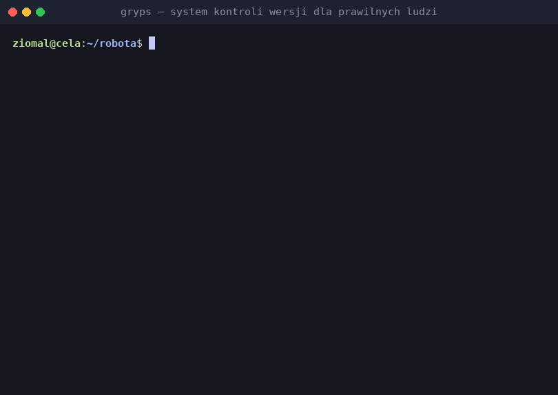

<div align="center">

```
   ____ ______   ______  ____
  / ___|  _ \ \ / /  _ \/ ___|
 | |  _| |_) \ V /| |_) \___ \
 | |_| |  _ < | | |  __/ ___) |
  \____|_| \_\|_| |_|   |____/
```

**System Kontroli Wersji dla Prawilnych Ludzi**

Git w grypserze. Koniec z frajerskimi komendami.

[](https://github.com/tkieron/gryps/actions/workflows/ci.yml)
[](https://github.com/tkieron/gryps/releases)
[](LICENSE)

</div>

---

## Po co GRYPS?

Gryps to nakładka na Gita, która nadaje codziennym komendom nazwy z gwary więziennej. Pod spodem zawsze pracuje zwykły `git`, a opcje Gita są przekazywane dalej (poza opisanymi skrótami). Gryps dokłada czytelne komunikaty, samouczek, podpowiedzi pod TABem i blokady przed przypadkową utratą roboty.

```bash
gryps lipo                          # co słychać pod celą?   (git status)
gryps skitraj                       # schowaj fanty          (git add -A)
gryps przyklep "Naprawiony zamek"   # podpisz się pod robotą (git commit -m)
gryps wywozka                       # wyślij urobek          (git push)
```

<p align="center">
  
</p>

## Pełen słownik komend

Ostatnia kolumna mówi, co robi komenda i jaki ma bezpieczny default. To samo w terminalu: `gryps podpowiedzi`, szczegóły jednej komendy: `gryps kmina <komenda>`.

### 📦 Codzienna robota

| Gryps | Git | Co robi / bezpieczny default |
|---|---|---|
| `mury [folder]` | `git init` | Stawiasz mury nowej celi |
| `jumaj <url>` | `git clone` | Zawijasz repo z wolki |
| `lipo` | `git status -sb` | Patrzysz przez lipo (oko), co się dzieje w celi |
| `kwity` | `git diff` + `git diff --cached` | Dwa zestawy dowodów: unstaged i staged; `--staged` tylko index |
| `skitraj [plik]` | `git add [-A]` | Kitrasz fanty; bez argumentów całe repo (`-A`), nie tylko bieżący katalog |
| `odkitraj [-- plik]` | `git restore --staged` | Zdejmujesz ze stagingu, pliki zostają |
| `przyklep <opis> [flagi]` | `git commit -m` | Przyklepujesz papiery bez `-m`; flagi po opisie trafiają do Gita; bez tożsamości podpowiada `meldunek` |
| `wywozka` | `git push` | Pierwszy push ustawia upstream wg konfiguracji remote; nie udaje sukcesu, gdy nic nie pojechało |
| `rakowiec` | `git pull --ff-only` | Odbierasz paczkę z wolki, bez samowolnego merge/rebase |
| `ucho` | `git fetch` | Stójka przy drzwiach: co nowego, bez ruszania plików |

### 🪪 Kartoteka grypsującego (od 1.4.0)

| Gryps | Git | Co robi / bezpieczny default |
|---|---|---|
| `ksywa [--global] [nazwa]` | `git config user.name` | Ksywa autora; domyślnie tylko to repo |
| `meta [--global] [email]` | `git config user.email` | Meta (adres) autora; domyślnie tylko to repo |
| `meldunek [--global] [nazwa email]` | `git config user.name` + `user.email` | Oba naraz; bez argumentów pyta, bez terminala wymaga obu |
| `kartoteka` | `git config --show-origin` | Efektywne dane i ich źródło (`[LOCAL]`, `[GLOBAL]`…) |

### 🚪 Cele i układy

| Gryps | Git | Co robi / bezpieczny default |
|---|---|---|
| `celka [nazwa]` | `git branch` | Lista cel albo nowa celka; `-d` likwiduje |
| `przerzutka <celka>` | `git switch` | Przeniesienie do innej celi (`-c` nowa, `-` powrót) |
| `spacer <cel>` | `git checkout` | Spacer po historii |
| `blaty <celka>` | `git merge` | Blatujesz się z inną celą; przy konflikcie podpowiada `--continue`/`--abort` |
| `uklady` | `git remote -v` | Kontakty z wolką |
| `tabor <baza>` | `git rebase` | Przewozisz commity na wskazaną bazę; baza wymagana, brudne drzewo tylko z `--autostash`, nigdy force-push |
| `podkopsaj <commit…>` | `git cherry-pick` | Przemycasz commit(y) z innej celi jako **nowe commity** (z `-n` tylko do stagingu) |

### 🕵️ Dochodzenie i historia

| Gryps | Git | Co robi / bezpieczny default |
|---|---|---|
| `kapus -- <plik>` | `git blame` | Kto sypnął tę linijkę? Wymaga pliku |
| `wizjer [hash]` | `git show` | Zaglądasz przez wizjer w commit |
| `bialko` | `git log --graph` | Kwity sprawy jako zwięzły graf wszystkich cel |
| `cynk` | `git reflog` | 20 ostatnich ruchów HEAD — tu odzyskasz cofnięte commity |
| `dziara [tag]` | `git tag` | Lista tagów (od najnowszego) albo nowa dziara |

### 🕳️ Dziupla

| Gryps | Git | Co robi / bezpieczny default |
|---|---|---|
| `dziupla` | `git stash push -u` | Chowa śledzone **i nowe** pliki, bez ignorowanych |
| `wyjmij` | `git stash pop` | Wyciągasz z dziupli na blat |
| `spis` | `git stash list` | Lista dziupli |
| `spusc` | `git stash drop` | Spuszczasz dziuplę; pyta o potwierdzenie (`-f` bez pytania) |

### 🚨 Ratunek

| Gryps | Git | Co robi / bezpieczny default |
|---|---|---|
| `kasacja <hash>` | `git revert` | Odwraca wyrok **nowym commitem**, bez przepisywania historii — dobre dla wywiezionych |
| `odkrec -- <plik>` | `git restore --worktree` | Odrzuca tylko zmiany unstaged; pyta o potwierdzenie |
| `kipisz` | `git reset --hard` | Twardy reset śledzonych plików! Pyta o potwierdzenie; **nie** usuwa nieśledzonych |
| `odklep [N]` | `git reset --soft HEAD~N` | Odkleja 1–N niewywiezionych commitów; zmiany zostają w stagingu, pliki nietknięte |
| `wykipruj` | `git clean -d` | Usuwa nieśledzone pliki **nieodwracalnie**; zawsze podgląd i zgoda albo jawne `-f` |

### 📖 Pomoc i komendy narzędziowe

| Gryps | Git | Co robi / bezpieczny default |
|---|---|---|
| `pomoc` | `gryps pomoc` | Pełen regulamin celi (przewijany w `less`) |
| `kmina <komenda>` | `gryps kmina` | Rozkmiń jeden gryps; to samo co `gryps <komenda> -h` |
| `bajera` | `gryps bajera` | Samouczek: typowy dzień na robocie |
| `podpowiedzi` | `gryps podpowiedzi` | Pogrupowana ściąga: gryps, znaczenie, Git |
| `wersja` | `gryps wersja` | Numer aktualnej odsiadki |

### 🔁 Aliasy

| Gryps | Git | Co robi / bezpieczny default |
|---|---|---|
| `kopsnij` | `git push` | To samo co `wywozka` (*kopsnąć rakietę* – wysłać paczkę) |
| `rakieta` | `git pull --ff-only` | To samo co `rakowiec` (*rakieta* – paczka) |
| `stojka` | `git fetch` | To samo co `ucho` (*stójka* – nasłuchiwanie przy drzwiach) |
| `zblatuj` | `git merge` | To samo co `blaty` (*zblatować się* – zbratać się) |

Globalna opcja `gryps --cicho <komenda>` (albo `GRYPS_CICHO=1`) wyłącza grypsowe komentarze. Czego Gryps nie tłumaczy, robisz zwykłym `git`.

## Co nowego? / Historia zmian

### v1.4.1 — Ratunek bez kipiszu
- Nowe grypsy: `odklep` (`git reset --soft`), `wykipruj` (`git clean -d`), `tabor` (`git rebase`), `podkopsaj` (`git cherry-pick`).
- **Zmiana niekompatybilna:** `skitrac` → `skitraj` (`git add`), bez aliasu. `gryps skitrac` kończy się błędem i niczego nie dodaje do stagingu, tylko podpowiada nową nazwę. W skryptach zamień `gryps skitrac` na `gryps skitraj` — argumenty i działanie są identyczne.
- `kipisz` podpowiada `wykipruj`, gdy po resecie zostały nowe pliki; `kmina kasacja` podpowiada `odklep`.
- Kompletny słownik w README, `podpowiedzi` i TAB (Bash, ble.sh, Zsh) z jednego katalogu.

### v1.4.0 — Kartoteka grypsującego
- `ksywa`, `meta`, `meldunek`, `kartoteka`; zapis domyślnie lokalny, `--global` tylko jawnie.
- `przyklep` bez anonimów: przy braku tożsamości podpowiada `meldunek`.

### v1.3.x — Akta, ślady i Smart TAB
- `kwity`, `odkitraj`, `kapus`, `dziara`, `cynk`, `kasacja`, `uklady`, `odkrec`; „Gryps gada” tylko w terminalu.
- Pogrupowane podpowiedzi TAB w Bash, ble.sh i Zsh; uczciwa `wywozka`.

Szczegóły i daty: [pełny CHANGELOG](CHANGELOG.md).

## Instalacja i aktualizacja

**Debian / Ubuntu** – pobierz `.deb` z [ostatniego wydania](https://github.com/tkieron/gryps/releases/latest):

```bash
sudo apt install ./gryps_*_all.deb
```

**macOS (Intel i Apple Silicon)** — pobierz z wydania paczkę `gryps-<wersja>-macos.zip` (Finder) lub `.tar.gz`. Bez Homebrew i bez `sudo`, dla domyślnego Zsh i systemowego Bash 3.2:

```sh
tar -xzf gryps-1.4.1-macos.tar.gz
cd gryps-1.4.1-macos
./install.sh --configure-zsh
# otwórz nowy Terminal
gryps wersja
```

Instrukcja i dezinstalator: [packaging/macos/README-macOS.md](packaging/macos/README-macOS.md). Instalacja trafia do `~/.local`. Potrzebny jest Git (na macOS wystarczą Command Line Tools).

**Jeden plik, bez roota** (bez podpowiedzi TAB i `man`):

```bash
mkdir -p ~/.local/bin
curl -fsSL https://github.com/tkieron/gryps/releases/latest/download/gryps -o ~/.local/bin/gryps
chmod +x ~/.local/bin/gryps
```

**Ze źródeł** — dwie drogi, obie wstawiają numer wersji z pliku `VERSION`:

```bash
git clone https://github.com/tkieron/gryps.git && cd gryps
make install PREFIX=~/.local     # albo: sudo make install (do /usr/local)
sh install.sh                    # albo: instalator do ~/.local z konfiguracją TAB w ~/.bashrc / ~/.zshrc
```

Wymagania: Git 2.23+ (z `git switch`) i Bash 3.2+. Na macOS zadziała systemowy Bash; powłoką interaktywną może być Zsh. Opcjonalnie `less` i ble.sh.

**Aktualizacja:** zainstaluj nową paczkę tak samo jak pierwszą i otwórz nowy terminal, żeby załadować aktualne podpowiedzi TAB. W istniejącej sesji Bash: `source /usr/share/bash-completion/completions/gryps` (`.deb`) albo plik z `~/.local/share/bash-completion/completions/`.

## Smart TAB (Bash / ble.sh / Zsh)

GRYPS podpowiada nazwy komend w kolejności grup, gałęzie, commity oraz **pliki względem bieżącego katalogu**. Separator `--` kończy opcje Gita i nie wyłącza podpowiedzi plików:

```bash
gryps kapus -- src/ts<TAB>
gryps skitraj -- src/<TAB>
gryps tabor orig<TAB>        # gałęzie lokalne i zdalne
```

Zwykły Bash pokazuje same nazwy, Bash + ble.sh opisy z odpowiednikiem Git, Zsh grupy z nagłówkami. Konfiguracja pionowej listy: [GRYPS TAB](docs/GRYPS-TAB-1.3.3.md).

## Bezpieczeństwo / dobre defaulty

Gryps wywołuje prawdziwego Gita, ale ma kilka jawnych ułatwień i zabezpieczeń. Nic nie wypycha samo, nie robi force-pusha i nie uruchamia poprawionej komendy po literówce.

**Jak cofnąć robotę — od najłagodniejszego:**

- `odklep` — commit jeszcze **nie** wywieziony: cofa 1–N ostatnich commitów, zmiany zostają w stagingu, pliki nietknięte. Przyjmuje tylko liczbę i `-f`, więc `--hard` nigdy nie dotrze do Gita. Odmawia przy merge w zakresie, w trakcie innej operacji i dla commitów obecnych na remote (wg stanu z ostatniego `gryps ucho`; `-f` świadomie pozwala, potem potrzebna `gryps wywozka --force-with-lease`). Cofnięte commity odzyskasz: `gryps przyklep -C ORIG_HEAD` albo `gryps cynk`.
- `kasacja <hash>` — commit **już** wywieziony: odwraca go nowym commitem, historia zostaje.
- `kipisz` — niszczy nieprzyklepane zmiany **śledzonych** plików (także staged). Pyta o potwierdzenie, bez terminala wymaga `-f`. **Nie** wykonuje `git clean`: nowe pliki zostają (wyjątek: kolidują z odtwarzanymi plikami śledzonymi).

**Sprzątanie nowych plików — `wykipruj`:**

- ⚠️ Usuniętych nieśledzonych plików **nie odzyska ani Git, ani `gryps cynk`**.
- `gryps wykipruj -n` tylko pokazuje listę. Zwykłe `gryps wykipruj` pokazuje listę, pyta o zgodę i przed usunięciem sprawdza, czy lista się nie zmieniła; bez terminala odmawia.
- `-f` usuwa bez pytania — tylko świadomie, np. w skryptach. Pliki z `.gitignore` zostają; `-x` usuwa także ignorowane (np. `.env`, `node_modules/`), `-X` tylko ignorowane. Zagnieżdżone repozytoria zostają zawsze.
- Pełny powrót do stanu z HEAD: `gryps kipisz && gryps wykipruj`.

**Przepisywanie historii:**

- `tabor` wymaga bazy (`gryps tabor main`), przy brudnym drzewie odmawia (chyba że `--autostash`) i ostrzega, gdy przewozi commity obecne na remote. Przy konflikcie zostawia rebase w toku: `gryps tabor --continue`, `--skip` albo `--abort`.
- `podkopsaj` tworzy nowe commity (bez `-x`, chyba że go podasz); merge commit wymaga `-m 1`.

**Pozostałe defaulty:**

- `skitraj` bez argumentów robi `git add -A` — bierze całe repo, nie tylko bieżący katalog;
- `wywozka` z ustawionym upstreamem sprawdza, czy są nowe commity. Gdy jest tylko staging, każe najpierw `przyklep`, zamiast ogłaszać udany transport. Na celce bez upstreamu (bez argumentów) przy `push.default=simple|upstream|current` używa `git -c push.default=current push --set-upstream`; Git **sam** wybiera remote (`branch.<celka>.pushRemote`, `remote.pushDefault` itd.). Z argumentami działa jak zwykły `git push`;
- `przyklep` zbiera wyrazy opisu tylko do pierwszej opcji: `gryps przyklep "feat" --no-verify`, `gryps przyklep -m "feat" --amend`. Tekst zaczynający się od `-` podawaj z `-m`;
- `dziupla` chowa zmiany śledzone **i nieśledzone** (`git stash push -u`), bez plików z `.gitignore`;
- komentarze grypsowe idą na stderr i tylko w terminalu. Dane Gita zostają na stdout, a w potokach, przy `--cicho` i formatach `--porcelain`, `-z`, `--quiet`, `--exit-code` Gryps nic nie dokleja. Kody wyjścia Gita są zachowane.

Kolory wyłączysz zmienną `NO_COLOR=1`. Same znikają, kiedy wyjście idzie do pliku albo potoku.

## Przykłady użycia

**Codzienna robota:**

```sh
gryps jumaj https://github.com/ekipa/projekt.git
gryps przerzutka -c nowa-robota
gryps kwity --stat
gryps skitraj
gryps przyklep "Naprawiony zamek w drzwiach"
gryps wywozka
```

**Ratunek:**

```sh
gryps odklep                        # ostatni commit wraca do stagingu
gryps odklep 3 && gryps przyklep "Jeden porządny commit"   # sklej trzy w jeden
gryps przyklep -C ORIG_HEAD         # rozmyśliłeś się: ten sam opis i autor
gryps odkitraj -- plik.txt          # zdejmij plik ze stagingu
gryps odkrec -f -- src/App.java     # UWAGA: traci zmiany unstaged
gryps wykipruj -n                   # podgląd nieśledzonych
gryps wykipruj -- build/ tmp/       # usuń tylko tu (zapyta)
gryps kasacja a1b2c3d               # odwróć wywieziony commit
```

**Cele i przemyt:**

```sh
gryps ucho && gryps tabor origin/main   # świeża baza z serwera
gryps tabor main --autostash            # luźne zmiany pojadą w dziupli
gryps tabor --continue                  # po rozwiązaniu konfliktu i gryps skitraj
gryps podkopsaj a1b2c3d                 # jeden commit z innej celi
gryps podkopsaj hotfix~2..hotfix        # zakres
gryps dziupla && gryps przerzutka hotfix   # awaryjna przerzutka
gryps --cicho lipo --porcelain -z       # czysto dla skryptów
```

## Skąd te słowa

Nazwy pochodzą z grypsery, gwary polskich więzień. Gdzie się dało, trzymamy się [słownika gwary więziennej](https://www.zpozdrowieniem.pl/blog/gamzac-grypsem-slownik-gwary-wieziennej): *rakieta* to paczka, *stójka* to nasłuchiwanie przy drzwiach, *przerzutka* to przeniesienie do innej celi, *kipisz* to rewizja. *Wykiprować* to wyrzucić, *podkopsać* — przekazać, przemycić, a *tabor* to transport. Kilka nazw (*jumaj*, *dziupla*, *bajera*) to ogólny polski slang, a *odklep* to nasz neologizm — odwrotność *przyklepu*. Projekt jest żartem językowym, nie pochwałą więziennej subkultury.

## Rozwój

```bash
make test       # testy na prawdziwych repozytoriach w katalogu tymczasowym
make lint       # shellcheck
make deb        # paczka .deb do dist/
make macos      # paczki .tar.gz i .zip dla macOS (Intel / Apple Silicon)
make demo       # od nowa renderuje docs/demo.gif (wymaga: pip install pyte pillow)
make promo      # pionowy short 9:16 do TikToka/Shorts (dodatkowo numpy i ffmpeg)
make skit       # 15-sekundowy skecz „Pod celą”
```

Specyfikacja bieżącej wersji: [docs/GRYPS_v1.4.1_SDD.md](docs/GRYPS_v1.4.1_SDD.md). Chcesz dorzucić komendę albo lepsze słowo? Zajrzyj do [CONTRIBUTING.md](CONTRIBUTING.md). Licencja: [MIT](LICENSE).

<details>
<summary>🇬🇧 English</summary>

**Gryps** is a thin Git wrapper that renames everyday commands into *grypsera*, Polish prison slang. `gryps skitraj` stashes away your loot (`git add`; called `skitrac` before 1.4.1), `gryps przyklep` stamps the papers (`git commit -m`), `gryps wywozka` ships it out (`git push`, setting the upstream for new branches), `gryps odklep` un-stamps the last unpushed commits keeping the changes staged (`git reset --soft`), `gryps wykipruj` throws out untracked files after a preview and confirmation (`git clean -d`), `gryps tabor` moves your commits onto a base (`git rebase`), `gryps podkopsaj` smuggles commits from another branch (`git cherry-pick`), and `gryps kipisz` is the cell search that discards tracked uncommitted changes (`git reset --hard`, with a confirmation prompt). Real `git` runs underneath; the documented shortcuts and safety checks are the only differences. Includes a tutorial (`gryps bajera`), Bash/ble.sh/Zsh completion, a man page and `.deb` / macOS packages. MIT licensed.

</details>

Jak Ci się podoba, zostaw ⭐ – w celi każda paczka się liczy.
